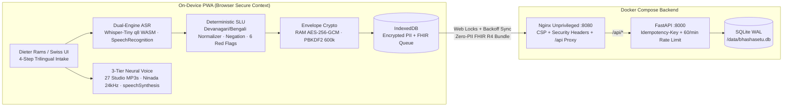

<div align="center">

# BhashaSetu Edge

**Offline-first, trilingual (Hindi · Hinglish · Bengali) clinical voice intake & ABDM FHIR R4 pre-triage PWA.**

[](https://developer.mozilla.org/en-US/docs/Web/Progressive_web_apps)
[](#1-one-command-quickstart)
[](#security--privacy-architecture)
[](#api-reference)
[](#api-reference)

*Built for frontline health workers (ASHAs) in low-connectivity clinics — structured symptom capture with human-in-the-loop review, zero autonomous diagnosis, and split on-device PII encryption.*

[Quickstart](#1-one-command-quickstart) · [Architecture](#2-system-architecture) · [Judge Walkthrough](#3-2-minute-judge-walkthrough) · [API Reference](#4-api-reference) · [Testing](#6-local-development--testing)

</div>

---

## Why BhashaSetu Edge?

Frontline health workers frequently triage patients speaking **Hindi, Hinglish, or Bengali** in rural or semi-urban clinics where mobile data is intermittent and cloud voice APIs are either blocked, expensive, or leak sensitive patient audio.

BhashaSetu Edge solves this on-device:
- **ICMR 2023 HITL-aligned:** Structures patient-reported symptoms, duration, spoken vitals, and red flags for clinician review without issuing autonomous diagnoses or prescriptions.
- **DPDP-aligned Split Storage:** Patient PII (`name`, `age`, `sex`, `abha_id`, `raw_transcript`) is encrypted locally with a RAM-only `AES-256-GCM` key; only **coarse-dated, zero-PII FHIR R4 bundles** are queued for server sync.
- **100% Zero-Key Boot:** Runs end-to-end on `localhost` with zero `.env` files, cloud credentials, or external LLM/ASR API keys.

---

## 1. One-Command Quickstart

### Prerequisites
- **Docker** & **Docker Compose** (or Node.js 20+ and Python 3.12+ for local development)
- **Chromium-based browser** (Chrome, Edge, or Brave) for full `SpeechRecognition`, WebCrypto, and WASM support

### Boot the Full Stack
```bash
docker compose up --build
```

Open **`http://localhost:8080`** in Chrome, Edge, or Brave.

| Service | Container / Port | Role |
| :--- | :--- | :--- |
| **`bhashasetu-edge`** | `nginxinc/nginx-unprivileged:1.27-alpine` · `:8080` | Serves the hardened Vite + Workbox PWA with strict CSP/security headers and reverse-proxies `/api/` to `api:8000`. |
| **`api`** | `backend/main.py` (FastAPI) · `:8000` (internal) | Persists anonymized FHIR R4 bundles in **SQLite WAL** (`bhashasetu_data` volume) with UUID `Idempotency-Key` deduplication and per-IP rate limiting (`60 req/min`). |

> [!NOTE]
> **Why `http://localhost:8080`?** Browsers treat `localhost` as a **secure context**, enabling microphone capture (`getUserMedia`), `crypto.subtle`, IndexedDB, Web Locks, and Service Worker registration without HTTPS certs or `.env` configuration.

---

## 2. System Architecture



### Core Engineering Pillars

| Layer | Implementation | Key Safeguards |
| :--- | :--- | :--- |
| **Dual-Engine ASR** | `Xenova/whisper-tiny` (`q8` ONNX WASM Worker) + Browser `SpeechRecognition` | `numThreads = 1` (no `COOP`/`COEP` needed), 30s decode watchdog, 60s recording cap, 2-strike visual icon fallback. |
| **3-Tier Neural TTS** | `src/tts/voiceEngine.ts` | **Tier 1:** 27 pre-rendered studio MP3 clips (`public/audio/`) at 0ms latency.<br>**Tier 2:** Lazy-loaded **Ninada 24 kHz** ONNX WASM (`gnumanth/ninada`) for dynamic readbacks.<br>**Tier 3:** Automatic `speechSynthesis` & visual caption fallback. |
| **Deterministic SLU** | `src/slu/normalize.ts` & `src/slu/parser.ts` | Unicode NFC + Devanagari/Bengali-to-Latin transliterator, clause-level negation/resolution separation, word-boundary matching, low-confidence (`< 0.85`) red-flag preservation (`requires_clinician_review: true`). |
| **Security & Privacy** | `src/crypto/vault.ts` & `src/db/storageGuard.ts` | Non-extractable `AES-256-GCM` DEK, optional 6+ char passphrase wrapping via **PBKDF2 (600,000 iterations, SHA-256)**, 5-min idle & `visibilitychange` auto-lock, encrypted `.bse.json` backup. |
| **Offline Sync** | `src/sync/queue.ts` & `public/sw.js` | Workbox precaching of hashed JS/CSS/WASM chunks, Web Locks + `BroadcastChannel` multi-tab coordination, honest state machine (`DRAFT` → `QUEUED` → `SENDING` → `ACKED` / `FAILED_RETRYABLE` / `FAILED_4XX`). |

---

## 3. 2-Minute Judge Walkthrough

1. **Immediate Encrypted Boot & Trilingual Intake**
   - The app boots straight into **Select patient language** (`हिन्दी`, `Hinglish`, `বাংলা`) using an ephemeral RAM-only 256-bit `AES-GCM` session key.
   - Tap a language, confirm verbal consent (Step 1), and speak or type a symptom phrase — or tap **Simulate** in the floating dark bottom pill to run any of **7 deterministic edge-case scenarios**.

2. **Clause-Level Negation & Clinical Red Flags**
   - Run **Scenario 1** (`"Bukhar nahi hai par seene mein tez dard hai do din se"`) or **Scenario 2** (`"Bukhar toh kal utar gaya, ab bas chhati bhari lag rahi hai"`).
   - Negated or resolved symptoms (`fever`) are separated from active red-flag triggers (`chest_pain`, `chest_heaviness`), surfacing an immediate clinician escalation banner and 4-tab **Doctor Handoff** modal (`Slip`, `FHIR`, `JSON`, `Cipher`).

3. **Offline ONNX Worker & Airplane Mode Reload**
   - Tap the **CPU** icon in the header to open the **Engine Drawer**, inspect `StorageManager` persistence/quota, and click **Load ~40MB ONNX** once to cache `Whisper-Tiny q8`.
   - Toggle **DevTools → Network → Offline** and hard-reload: Workbox `sw.js` boots the full app shell and queues encounters as `QUEUED` (never falsely `ACKED`).

4. **Idempotent Sync & Encrypted Backup**
   - When online, open **Queue → Sync** to post anonymized FHIR R4 bundles to `POST /api/abdm/fhir-intake` (`1s → 2s → 4s` backoff on 5xx/network errors).
   - Tap **Export Encrypted Backup (.bse.json)** to download encrypted IndexedDB records + wrapped vault metadata (zero plaintext).

5. **Optional Passphrase Vault Lock**
   - Tap **Session Encryption Active · Set Passphrase to Lock** (or the header **Lock** icon) to wrap the DEK with PBKDF2 (`600,000` iterations), enabling `visibilitychange` auto-lock, encrypted `DRAFT` autosave, and **Wipe & Reset Vault**.

---

## 4. API Reference

All endpoints are served via Nginx at `http://localhost:8080/api/*` (or directly on FastAPI `:8000`).

### `GET /api/health`
Verifies API liveness and SQLite WAL journal mode.
```bash
curl -sSf http://localhost:8080/api/health
```
```json
{ "status": "ok", "db": "sqlite-wal" }
```

### `POST /api/abdm/fhir-intake`
Persists an anonymized ABDM FHIR R4 `Bundle` with strict UUID idempotency and per-IP rate limiting (`60 req/min`).

- **Required Headers:**
  - `Content-Type: application/json`
  - `Idempotency-Key: <UUIDv4>` (returns `400` if missing or invalid UUID)
- **Optional Headers:**
  - `X-Device-Id: <string>` (max 128 chars; defaults to `"anonymous-device"`)

```bash
curl -sS -X POST http://localhost:8080/api/abdm/fhir-intake \
  -H "Content-Type: application/json" \
  -H "Idempotency-Key: 550e8400-e29b-41d4-a716-446655440000" \
  -H "X-Device-Id: asha-tablet-01" \
  -d '{
    "resourceType": "Bundle",
    "type": "collection",
    "identifier": { "value": "enc-2026-001" },
    "entry": [{ "resource": { "resourceType": "Encounter", "id": "enc-2026-001" } }]
  }'
```
- **`201 Created`:** `{ "status": "acked", "encounter_id": "enc-2026-001", "received_at": "..." }`
- **`200 OK` (replay):** `{ "status": "duplicate_ignored", "encounter_id": "enc-2026-001", "received_at": "..." }`
- **`422 Unprocessable Entity`:** Missing `Bundle.identifier.value` / `Encounter.id` or invalid `resourceType`
- **`429 Too Many Requests`:** Per-IP sliding window (`60 req/min`) exceeded

### `GET /api/abdm/encounters`
Lists synced encounter metadata scoped to `X-Device-Id` (`limit` clamped to `1..100`, default `25`).
```bash
curl -sSf -H "X-Device-Id: asha-tablet-01" "http://localhost:8080/api/abdm/encounters?limit=10"
```

---

## 5. Project Structure

```text
bhashasetu-edge/
├── backend/
│   ├── main.py                  # FastAPI + SQLite WAL sync API & rate limiter
│   ├── test_main.py             # Pytest suite (health, idempotency, validation, 429)
│   ├── requirements.txt
│   └── Dockerfile               # Non-root Python 3.12-slim image
├── src/
│   ├── asr/                     # Whisper ONNX Web Worker + browser SpeechRecognition
│   ├── components/              # Swiss UI, 4-tab Doctor Handoff modal, Engine Drawer, Lock Gate
│   ├── crypto/vault.ts          # AES-256-GCM DEK + PBKDF2 600k wrapping + .bse.json backup
│   ├── db/                      # IndexedDB store + StorageManager quota guard
│   ├── fhir/                    # Anonymized ABDM FHIR R4 bundle builder
│   ├── slu/                     # Devanagari/Bengali normalizer, SLU parser, validators, schema
│   ├── sync/queue.ts            # Web Locks + BroadcastChannel + exponential backoff sync
│   └── tts/voiceEngine.ts       # 3-tier neural TTS (MP3 clips -> Ninada -> speechSynthesis)
├── public/
│   ├── audio/                   # 27 pre-rendered studio MP3 prompt clips (hi, hinglish, bn)
│   └── manifest.json            # Installable standalone PWA manifest & icons
├── scripts/                     # Prompt audio generation utilities
├── e2e/                         # Playwright Chromium end-to-end tests
├── docker-compose.yml           # Full-stack orchestration (api + bhashasetu-edge)
├── Dockerfile                   # Multi-stage Node build -> Nginx unprivileged runtime
└── nginx.conf                   # Hardened CSP, security headers, /api/ reverse proxy
```

---

## 6. Local Development & Testing

### Frontend (Vitest + Vite + Playwright)
```bash
npm ci
npm test                             # Vitest unit suites (SLU normalizer/parser, validation, VaultCrypto)
npm run build                        # TypeScript check + production Vite + Workbox sw.js bundle
npx playwright install chromium      # First-time browser binary setup
npm run test:e2e                     # Playwright Chromium E2E suite
```

> [!TIP]
> `npm run dev` starts the Vite dev server on `:5173`. To test `/api/*` sync outside Docker, run the FastAPI backend locally (`uvicorn main:app --port 8000` inside `backend/`) or use `docker compose up --build`.

### Backend (Pytest)
```bash
# Inside running Docker Compose stack:
docker compose exec -T api pytest

# Or locally in Python 3.12+:
cd backend && pip install -r requirements.txt && pytest
```

---

## 7. Known Limitations & Clinical Disclaimer

- **Clinical Disclaimer:** BhashaSetu Edge is a **pre-triage intake and structuring tool**, not a medical device. It does not diagnose, prescribe, or replace qualified clinical judgment. All red-flag alerts and low-confidence parses require human clinician verification.
- **Ephemeral Key Scope:** On initial boot without a passphrase, the `AES-256-GCM` key lives strictly in RAM; refreshing the page without setting a passphrase or exporting a `.bse.json` backup discards access to prior ephemeral records.
- **Rule-Based SLU:** Symptom extraction uses deterministic normalization and curated trilingual lexicons rather than a generative LLM, ensuring predictable offline behavior at the cost of narrower out-of-vocabulary coverage.
- **Single-Node Persistence:** The sync backend uses single-node SQLite WAL and an in-memory per-IP rate limiter, suited for edge/clinic gateways and hackathon evaluation rather than multi-region horizontal scaling.
